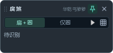

# 戾煞 · 配平助手

Windows 团队面板识别与配平悬浮工具，由 **华乾·丐箩箩** 制作。当前版本 **0.5.0**。



框选游戏内完整的 25 人团队面板，校准网格后持续识别赤／幽 Buff、层数、隔绝和重伤，并给出配平口令及个人标记。识别使用随包 CPU ONNX 模型，运行需要 Windows 10 2004 或更新版本，推荐 Windows 11 和窗口化／无边框游戏。

## 安装与启动

### Windows 免安装包

项目的 GitHub Actions 为 Python 3.12 构建 `LishaOverlay-windows-x64`。下载后完整解压，打开 `LishaOverlay.exe`，保留同目录的 `_internal` 文件夹。

### 源码运行

需要 Python 3.12 或更新版本，持续集成检查 Python 3.12 和 3.13。

```powershell
git clone https://github.com/66maer/lisha-balancer.git
cd lisha-balancer
python -m venv .venv
.\.venv\Scripts\python.exe -m pip install -e ".[dev]"
.\.venv\Scripts\python.exe main.py
```

安装完成后也可双击 `启动工具.cmd`，或运行虚拟环境中的 `lisha-overlay`。`requirements.txt` 作为安装兼容入口，依赖版本统一维护在 `pyproject.toml`。

## 使用

1. 将扫描框覆盖完整 25 格团队面板，留出少量边缘空白。支持每列五人，以及 5 列、3+2、2+3、1+4、4+1 的队伍排列。
2. 点击网格图标完成校准，再选择“扇＋圈”或“仅圈”，点击开始。每次启动、移动或缩放扫描框后都需重新校准。
3. 按面板提示执行。红色扇形标记表示吃扇，黑圈内的数字表示圈序，同一格可以有多个圈标记。
4. 停止后可拖动边框或抓手调整区域，控制条可独立拖动。扫描框内部透明并允许鼠标穿透，开始后位置锁定。
5. 右键控制条或使用托盘菜单进入设置、切换“正平优先”或导出调试包。设置预览支持逐格修正，改变区域或布局会清除旧校正。

主工具条为紧凑布局，长口令会自动增加高度。角落的作者水印允许鼠标穿透，标题栏拖动及按钮操作照常使用。

识别只采集框内区域。当前版本支持桌面录屏和远程桌面显示，取图瞬间短暂隐藏标记层。录屏可使用包含悬浮窗口的桌面／显示器采集。

## 配平规则

- 按本帧存活玩家的实际 Buff 计算，支持赤／幽 1～4 层及隔绝，当前规则直接读取画面状态。
- 默认选择参与人数较少的方案。可切换“正平优先”，在已验证人数范围内选择更接近红黑人数相等的方案。
- 25 人存活、初始黑三至红三、无预先隔绝时使用随包策略库。三名引导另计，额外补位／排除最多五人。两次提词分别位于扇形前和圈前。
- 引导 1 去主点，2 单走，3 去旁点。双圈站主点与旁点交集，三圈使用三角交集。队伍位置优先安排 1、2 队，再安排 3、4 队。
- 人数差绝对值不超过 2 时视为平衡，减少额外操作。低层黑人数不足三名时提示另排引导。
- 死亡、已有隔绝和四层状态采用扩展求解，显示“参考”。每份输出方案均独立重放验算，包含强消融时在详情中提示。
- 求解失败会显示“无解，等死吧”，其范围受当前站位与动作模型约束。实际执行仍需考虑气血、治疗和移动路线。

首帧、状态变化或识别存在疑点时显示“参考”。整队连续两帧一致且无疑点后才去掉该提示。定位失败或采集异常会暂停输出。

## 本地策略实验页

```powershell
.\.venv\Scripts\python.exe tools/strategy_lab.py
```

打开 <http://127.0.0.1:18776/>，可修改 25 个格子的状态并检查口令、标记和逐步结算。`/catalogue` 提供全人数分布浏览。服务默认绑定本机地址，直接读取随包策略库，也可用 `--data` 指定兼容的数据目录、`--port` 指定端口。

## 开发与验证

```powershell
.\.venv\Scripts\python.exe -m ruff check .
.\.venv\Scripts\python.exe -m pytest -q
.\.venv\Scripts\python.exe main.py --check-runtime
.\.venv\Scripts\python.exe -m build
```

测试覆盖核心求解、独立重放、识别、图像转换、采集生命周期、网格、配置、界面与本地实验页。少量私有截图回放通过测试中列出的 `LISHA_*` 环境变量显式启用。模型文件和策略库包含在 wheel 中，持续集成会在独立环境安装 wheel 并运行自检。

Windows 免安装打包命令如下。

```powershell
powershell -ExecutionPolicy Bypass -File tools/build.ps1
```

产物为 `dist/LishaOverlay/`，打包脚本自动校验运行环境。已有 Python 环境可通过 `-Python` 指定解释器。打包目录附带项目和第三方许可声明。

### 项目结构

```text
src/lisha_overlay/    应用、界面、采集、识别与求解
  assets/learned/    CPU 模型及识别参照
  assets/strategy/   离线生成的策略数据
  assets/buffs/      重伤匹配与诊断图标
tests/               公开回归测试
tools/               打包、策略实验与诊断工具
assets/              应用图标、界面预览与发行说明
.github/workflows/   自动检查和 Windows 构建
```

本地历史训练工作区、原始截图、运行日志和生成产物通过忽略规则隔离。公开工程的安装、运行和常规测试均使用随项目提供的资源。

## 日志与诊断

配置和日志保存在 `%LOCALAPPDATA%\LishaBalancer\`。普通启动保存容量受限的运行日志及分析 JSON。需要复现识别问题时显式开启截图诊断。

```powershell
.\.venv\Scripts\python.exe main.py --debug-captures
.\.venv\Scripts\python.exe main.py --export-debug .\support.zip
```

截图诊断保存最近选区原图、标记图和局部 Buff 裁片，并按最近一次结果覆盖。`--no-debug-captures` 优先关闭图片保存。调试包包含本地环境、日志和现有诊断文件，分享前请检查其中的游戏画面。

可通过 `main.py --quit` 退出已有工具，通过 `--locate`、`--analyze all`、`--analyze circle` 提交校准或分析命令。

## 验证边界

模型配置记录了 743 条人工答案的开发背景和已知限制。这些样本参与过开发，现有回归结果用于检查兼容性。新账号、不同界面缩放、遮挡样式和真实游戏负载仍需实际验证。模型分值用于候选排序。

## 许可与反馈

作者自有代码及策略数据采用 [MIT 许可](LICENSE)。依赖、模型来源与游戏识别裁片的权利说明见 [第三方声明](THIRD_PARTY_NOTICES.md)。

提交问题时请附上版本、Windows 版本、显示缩放、复现步骤及经检查的调试包。提交修改前请运行上面的检查命令，并更新受改动影响的现有测试。
